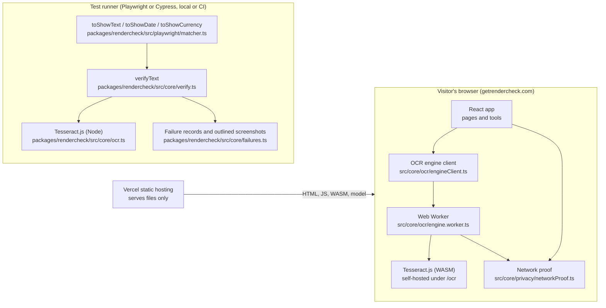
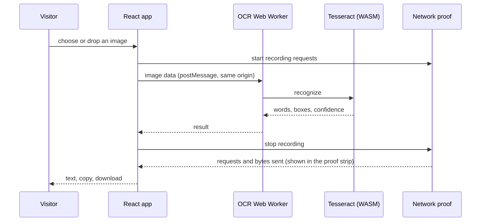
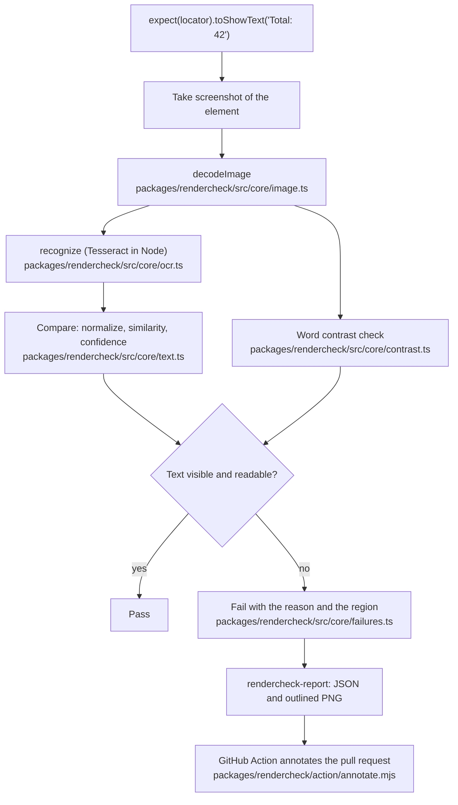

# Architecture

RenderCheck has one idea: read pixels with OCR on the machine that already has them, and never send them anywhere. This document shows how that is built and, for each claim, where the code or test that backs it lives. A test (`src/test/architectureDoc.spec.ts`) fails if a file named here no longer exists.

## 1. System context

Two surfaces share one rule: no image leaves the machine that holds it.

Nothing in the browser box talks to a server after the static files load, and nothing in the test-runner box needs the network once the English model is installed with the package.

## 2. Browser path: where an image goes

The proof strip on `/image-to-text` shows what the network proof measured for that run. It sees requests from the page and the worker it starts; it cannot see other workers, which is why the Content Security Policy below is the enforcing control and the proof strip is the visible check.

## 3. SDK path: how an assertion runs

The Playwright and Cypress adapters (`packages/rendercheck/src/playwright/index.ts`, `packages/rendercheck/src/cypress/plugin.ts`) are thin: both call the same `verifyText` in core.

## 4. Trust boundary and threat model

| Threat | Control | Where it is enforced | How it is checked |
|---|---|---|---|
| An image or its text is sent to a server | `connect-src 'self'` in the Content Security Policy blocks every cross-origin request | `vercel.json` | `e2e/no-third-party.spec.ts` checks that each route requests only its own origin; the e2e server applies the same headers (`e2e/server.mjs`) |
| A third-party script runs on the page | `script-src 'self' 'wasm-unsafe-eval'` | `vercel.json` | `e2e/no-third-party.spec.ts` checks the CSP allows no ad or analytics host and that routes load no outside script |
| The OCR worker loads code from elsewhere | `worker-src 'self' blob:`; worker, core and language data are self-hosted under `/ocr` | `src/core/ocr/tesseractConfig.ts` | `e2e/smoke.spec.ts` checks the worker, core and English model are served from `/ocr` |
| The page embeds or is embedded by another site | `frame-ancestors 'none'`, `object-src 'none'`, `base-uri 'self'` | `vercel.json` | headers applied in e2e |
| A visitor cannot tell whether anything was sent | Per-run request and byte counts | `src/core/privacy/networkProof.ts` | `src/core/privacy/networkProof.spec.ts`, `src/test/imageToTextTool.spec.tsx` |
| Site copy claims more than the product does | Banned-phrase check in CI | `scripts/check-claims.mjs` | runs in `npm run check:copy` |

Out of scope and stated plainly: the project has no security certification and has not had a third-party penetration test. The Security page says the same.

## 5. Decisions

- **Local OCR, not an API.** The product is the guarantee that pixels stay on the machine. An API would remove that guarantee, so no cloud OCR is used.
- **Tesseract.js, English model only.** It runs in WebAssembly in both the browser and Node. Other languages need a language file supplied with `langPath`; the browser tool ships English only, and its copy says so.
- **A worker, not the main thread.** Recognition is CPU heavy; a module worker keeps the page responsive.
- **Self-hosted engine files.** A strict CSP is only possible if the worker, core and model are same-origin.
- **Prerendered static pages.** Every route is rendered to HTML at build time (`scripts/prerender.mjs`) in CI, and a post-deploy check (`scripts/check-live-seo.mjs`) fetches the live HTML to confirm it.
- **One deploy path.** GitHub Actions builds and deploys a prebuilt output (`.github/workflows/deploy.yml`); Vercel's Git deploys are off.
- **Specs as contracts.** See `docs/adr/0001-adopt-sdd.md`.
